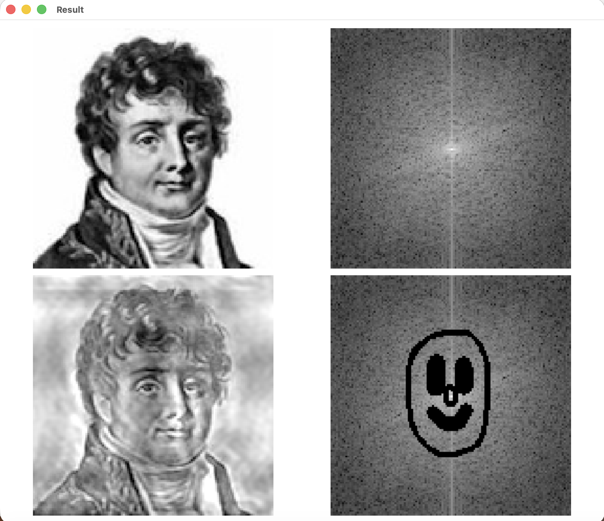
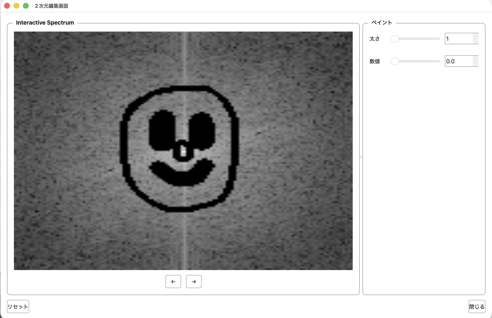

# FourierProject

フーリエ変換（離散フーリエ変換・高速フーリエ変換）を用いた信号解析および周波数スペクトル可視化ツール

---

## 📌 概要
本プロジェクトは、数学的理論であるフーリエ解析（Fourier Analysis）をプログラミングによって実装し、入力信号（時系列データ・音声・波形データなど）から周波数成分を抽出・可視化するための解析プロジェクトです。

フーリエ変換・逆フーリエ変換をわかりやすく理解する教育的な目的として作成しました

---

## 🛠 主な機能
- **離散フーリエ変換 (DFT) / 高速フーリエ変換 (FFT) の実装**
  - 入力データに対する周波数分解およびパワースペクトルの算出
- **周波数スペクトルの可視化**
  - 時間領域信号（波形）と周波数領域信号（スペクトル）の対比表示
- **周波数スペクトルの編集**
  - マウス操作によるパワースペクトルの数値の編集
- **逆フーリエ変換 (IDFT / IFFT) による信号再構成（※実装している場合）**
  - フィルタリング後の周波数データから時間領域波形への復元

---

## 💻 技術スタック
| カテゴリ | 技術・ライブラリ | 用途 |
| :--- | :--- | :--- |
| **開発言語** | Python 3.12.0 | メイン実装言語 |
| **GUI** | PyQt6 (`6.11.0`) | デスクトップGUIフレームワーク |
| **数値計算・アルゴリズム** | NumPy (`2.4.6`) | 多次元配列処理、高速フーリエ変換（FFT）演算 |
| **画像処理** | Pillow (`12.2.0`) | 入出力画像の読み込み・フォーマット変換・前処理 |
| **テスト・品質保証** | pytest (`9.1.0`), pytest-qt (`4.5.0`) | ロジックの単体テストおよびGUIイベント・操作テスト |
| **レポーティング・補助** | pytest-html (`4.2.0`), Jinja2, Pygments | テスト実行結果のHTMLレポート生成、シンタックスハイライト |

---

## 📊 実行例
| 実行画面 | 編集画面 |
| :---: | :---: |
|  |  |

---

## 🚀 環境構築・実行手順

### 1. リポジトリのクローン
```bash
git clone [https://github.com/AzumaTakumi/FourierProject.git](https://github.com/AzumaTakumi/FourierProject.git)
cd FourierProject
```

### 2. 仮想環境の構築
```bash
python -m venv .venv
source ./venv/bin/activate
pip install -r requirements.txt
```

### 3. 実行
make run
